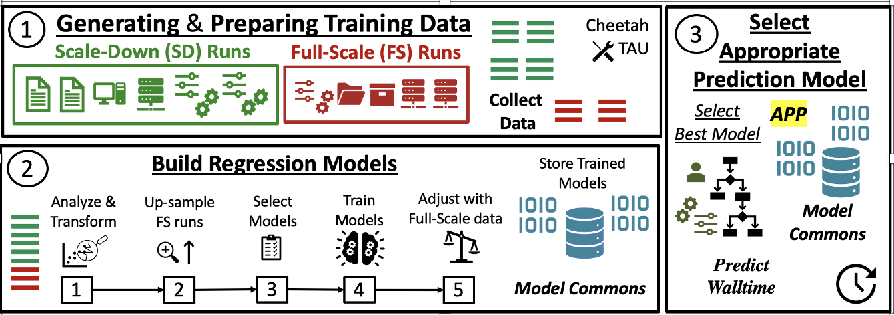

# HARP UI - HPC Application Runtime Predictor

HARP profiles scientific applications across high-performance computing (HPC) systems, builds regression models from the resulting execution history, and predicts application runtime and resource needs. **HARP UI** is the browser front end for that workflow: one web page, backed by a small FastAPI server, that turns a profiling sweep into many Tapis jobs across several systems, collects their results, trains runtime estimators, and lets you pick the best model, all through your own Tapis account. It runs on your laptop, on a shared HTTPS server, or as an ICICLE Tapis Pod embedded in TapisUI.

> Looking for the earlier notebook (Colab + Tapis container) workflow or the installable OSC/Linux module (`module load harp`)? See the [legacy guide](Documents/README_legacy_notebook_and_module.md).

**Tags:** Software, AI4CI

### License

[](https://opensource.org/licenses/BSD-3-Clause)

HARP is distributed under the [BSD 3-Clause License](LICENSE).

## References

- [HARP source repository](https://github.com/manikyaswathi/HARP-UI)
- [Deployed HARP service](https://harp.pods.icicleai.tapis.io)
- [HARP sweep-server reference](harp_server/README.md) (API, environment variables, internals)
- [Tapis Pods deployment guide](deploy/README.md)
- [Offline UI demo](DEMO/ui/README.md)
- [Legacy notebook and module guide](Documents/README_legacy_notebook_and_module.md)
- [Tapis documentation](https://tapis.readthedocs.io/)
- [CODAR Cheetah](https://github.com/CODARcode/cheetah)

## Acknowledgements

*National Science Foundation (NSF) funded AI institute for Intelligent Cyberinfrastructure with Computational Learning in the Environment (ICICLE) (OAC 2112606)*

## Issue reporting

Report defects and feature requests through [GitHub Issues](https://github.com/manikyaswathi/HARP-UI/issues). Include the HARP version, where the UI runs (laptop, HTTPS server, Tapis Pod / TapisUI), the Tapis tenant, reproduction steps, and relevant logs. Never include access tokens or passwords.

---

# Tutorials

## Try the UI offline (no Tapis needed)

Open [`DEMO/ui/profiling.html`](DEMO/ui/profiling.html) in a browser and log in with any username and password. It runs on built-in sample apps, systems, sweeps and data, so you can walk through every tab before touching a real cluster.

## Use the hosted service

1. Sign in to the ICICLE TapisUI (`https://icicleai.tapis.io`) and open the **HARP** page. TapisUI hands your access token to HARP automatically; there is no second login.
2. Or open [https://harp.pods.icicleai.tapis.io](https://harp.pods.icicleai.tapis.io) directly and paste a current Tapis access token (JWT).

You still need Tapis credentials and an allocation on the systems you profile on (see [Prerequisites](#prerequisites)).

## Run HARP UI on your laptop

Requires macOS or Linux, Python 3.11 or 3.12, and this repository.

```bash
git clone https://github.com/manikyaswathi/HARP-UI.git
cd HARP-UI
./harp_server/scripts/run_local.sh
```

Open `http://localhost:8000`. The first run creates `harp_server/.venv` and installs FastAPI, Uvicorn and tapipy, plus pandas, scikit-learn and TensorFlow for local model builds (set `HARP_NO_BUILD=1` to skip those). The server listens on `127.0.0.1` only. State is kept in `~/.harp_server`.

Keep the laptop awake while sweeps run (on a Mac: `caffeinate -i ./harp_server/scripts/run_local.sh`). If it sleeps or you stop the server, jobs already in Tapis keep running; start the server again, log in, and it picks the sweeps back up.

## Walk through a first sweep

The Euler-number example ([`examples/01-eulers_number`](examples/01-eulers_number/README.md)) is the quickest end-to-end test.

1. **Log in** with a Tapis access token.
2. **HARP Generate → Configure:** pick the `harp-sweep-euler` app, choose a run type (SD, FS or test_data), repetitions, timeout and parameter values; tick systems and queues, set each queue's hardware (cores, memory, minutes) and your allocation account (e.g. `-A PAS2271`); add the sweep to the plan. Repeat for the other run types.
3. **Review & submit:** HARP checks every sweep against Tapis and shows what each job will request. Pick the results location, optionally a second location to copy results to, and submit (all or nothing).
4. **Jobs:** watch each Tapis job and its runs done; cancel a sweep if needed.
5. **Profiled data:** when the jobs finish, see every execution with its parameters, hardware and walltime, medians by run type and hardware, and export CSV.
6. **HARP Build:** pick the sweeps to learn from (at least 2 SD, 4 FS and 1 test_data run), pick models (LR, NN, DTR) and training sets, and run the build as a Tapis job or on this computer.
7. **HARP Estimate:** enter one value per parameter, tick candidate queues and cores, select a trained model (the best is preselected), and view the estimates.

---

# How-To Guides

## Prerequisites

HARP UI does every cluster operation through Tapis (Systems, Files, Apps, Jobs); it never touches a cluster file system directly. Before profiling an application you need:

1. **Execution systems and credentials** registered in Tapis for each cluster (e.g. OSC Pitzer, TACC). The notebooks [`Executing_HARP_using_TAPIS*.ipynb`](Notebooks/) show how.
2. **An allocation account** on each system.
3. **A sweep container** for your application, and **a Tapis app** for it whose `notes.harp` block describes its command, work folder and parameters.

## Package your application for sweeps

1. Build and push the job container, starting from [`DockerFiles/Dockerfile_App_Template_Sweep`](DockerFiles/Dockerfile_App_Template_Sweep) (the Euler example is [`Dockerfile_App_EulerNumber_Sweep`](DockerFiles/Dockerfile_App_EulerNumber_Sweep)):
   ```bash
   docker build -f DockerFiles/Dockerfile_App_EulerNumber_Sweep -t <hub>/harp-sweep-eulernumber:1.0.0 .
   docker push <hub>/harp-sweep-eulernumber:1.0.0
   ```
   Make the image public so the clusters can pull it.
2. Register (or update) the Tapis app with [`Notebooks/Create_HARP_Sweep_App_TAPIS.ipynb`](Notebooks/Create_HARP_Sweep_App_TAPIS.ipynb). It can also run one small test job.

Inside each job, [`job_runner/harp_job_runner.py`](job_runner/harp_job_runner.py) runs its parameter combinations x repetitions, measures walltime and hardware, and writes `harp_profile.csv` and `harp_progress.json` to the Tapis output directory.

## Register the build app (Tapis model training)

[`DockerFiles/Dockerfile_HARP_Build`](DockerFiles/Dockerfile_HARP_Build) packages the pipeline and [`job_runner/harp_build_runner.py`](job_runner/harp_build_runner.py). Push it as `harp-build:1.0.0` and register it with `Create_HARP_Sweep_App_TAPIS.ipynb` using `APP = "build"`; its notes carry `role: "build"`, which is how the UI finds it. Without it, builds can still run on the computer hosting the server.

## Run HARP UI as a shared HTTPS server

The server receives Tapis access tokens, so anything other than `localhost` must use HTTPS.

```bash
pip install -r harp_server/requirements.txt
cd harp_server
./scripts/make_dev_cert.sh certs <server-hostname>      # testing only: self-signed
HARP_SSL_CERT=certs/cert.pem HARP_SSL_KEY=certs/key.pem python3 -m harp_server.serve
```

Open `https://<server-hostname>:8443`. For real use, point `HARP_SSL_CERT` / `HARP_SSL_KEY` at an institutional or Let's Encrypt certificate. Behind nginx, Caddy or Apache, run `HARP_BEHIND_PROXY=1 HARP_PORT=8000 python3 -m harp_server.serve` and forward with an `X-Forwarded-Proto` header.

| Variable | Purpose | Default |
|---|---|---|
| `HARP_SSL_CERT`, `HARP_SSL_KEY` | Certificate and key (PEM) | required unless behind a proxy |
| `HARP_HOST`, `HARP_PORT` | Listen address | `0.0.0.0:8443` |
| `HARP_BEHIND_PROXY` | Serve plain HTTP and trust the proxy's forwarded headers | off |
| `HARP_SERVER_DATA` | Campaign and build state directory | `~/.harp_server` |
| `HARP_POLL_SECONDS` | Tapis polling interval | `15` |
| `HARP_TAPIS_BASE_URL` | Tenant used to validate tokens | `https://icicleai.tapis.io` |
| `HARP_PORTAL_ORIGINS` | Exact TapisUI origins allowed to frame HARP and hand off tokens | unset (framing disabled) |
| `HARP_SESSION_SAME_SITE` | Session cookie policy (`strict`, `lax`, `none`; `none` for the iframe) | |
| `HARP_ALLOW_HTTP` | Accept logins over plain HTTP (never on a shared server) | off |

## Deploy as an ICICLE Tapis Pod (TapisUI)

Build and publish the server image ([`harp_server/Dockerfile`](harp_server/Dockerfile)), create the `harpdata` volume, and register the Pod template and Pod with [`deploy/deploy_pod.py`](deploy/deploy_pod.py):

```bash
docker build -f harp_server/Dockerfile -t ghcr.io/manikyaswathi/harp-ui:2.0.0 .
docker push ghcr.io/manikyaswathi/harp-ui:2.0.0

export TAPIS_BASE_URL=https://icicleai.tapis.io
export TAPIS_ACCESS_TOKEN='<token>'
export HARP_IMAGE=ghcr.io/manikyaswathi/harp-ui:2.0.0
python deploy/deploy_pod.py
curl https://harp.pods.icicleai.tapis.io/healthz      # {"status":"ok"}
```

Full steps, portal settings and operational constraints (run a single replica) are in [`deploy/README.md`](deploy/README.md).

## Run the tests

```bash
cd harp_server && python3 -m pytest -q tests
```

The tests use an in-memory fake of Tapis ([`tests/fake_tapis.py`](harp_server/tests/fake_tapis.py)); the job runner is tested by really running the Euler example.

## Rebuild the offline demo

After changing [`profiling.html`](profiling.html), regenerate the demo copy with `python3 DEMO/ui/build_demo.py`.

---

# Explanation

## Why HARP

Each HPC workflow has its own compute, memory and I/O profile, and users routinely over- or under-request resources because they lack a history of runs to go by. HARP generates that history systematically, with many "scaled-down" (SD) runs, a few selective "full-scale" (FS) runs and held-out test_data runs, then trains regression models to estimate runtime for a target application on a given system and queue.



## From notebooks to the UI

Earlier versions ran the whole Cheetah campaign inside **one** container, so one Tapis job ran every sweep combination on one machine, driven from a notebook or an installed module. HARP UI keeps the same pipeline and data format but changes how the generate phase runs:

```
 Browser UI ──► HARP server ──► Tapis Jobs ──► job on system A ─┐
  (Generate,     expand combos,   (one job      job on system B ─┼─► harp_profile.csv per job
   Build,        split into jobs,  per chunk)   job on system C ─┘
   Estimate)     throttle, poll  ◄── Tapis Files: merge ──► <storage>/<campaign>/<app>_<timestamp>.csv
```

- **Split** spreads jobs round-robin over the selected systems; **replicate** runs every job on every system to profile across hardware.
- Each job's hardware comes from its queue (cores, memory, walltime) and is checked against the queue's Tapis limits before submission.
- The server respects each system's concurrent-job limit, reads live progress through Tapis Files, and merges CSVs when every job ends. Failed runs go to `harp_failures.csv`, so they never pollute training data.
- The merged CSV keeps the pipeline's columns (`run_config, run_type, sys_*, run_<param>, walltime`), so the existing build modules (`pipeline/modules/pipeline.py`: preprocessing with outlier removal, scaling and PCA, then model training) consume it unchanged.

## The three tabs

| Tab | Steps |
|---|---|
| **HARP Generate** | Configure sweeps → Review & submit → Profiled data → Jobs |
| **HARP Build** | Training data → Models & where → Trained models |
| **HARP Estimate** | Configure → Select model → Estimates |

The **?** buttons in the UI explain each term: SD / FS / test_data runs, sweeps and campaigns, models, training sets, and how models are scored (average error and how often a model predicts too low on test_data runs).

## Security and multi-user isolation

- HARP accepts Tapis access tokens only, never usernames or passwords. The token stays on the server; the browser gets an HttpOnly session cookie that JavaScript cannot read.
- Inside TapisUI, the iframe receives the token from its exact parent origin via `postMessage`. Tokens are never placed in URLs or browser storage.
- Every sweep, job, dataset and build belongs to the Tapis user **and** tenant that created it, and is read through that user's own token.
- When a token expires, running sweeps pause (`WAITING_FOR_LOGIN`) and resume once the user signs in again. Campaign state is stored as JSON, so it survives server restarts.

## Repository layout

| Path | Contents |
|---|---|
| [`profiling.html`](profiling.html) | The single-page UI |
| [`harp_server/`](harp_server/) | FastAPI server: plan, sweep, campaign tracking, Tapis gateway, builds, tests |
| [`job_runner/`](job_runner/) | Code that runs inside profiling and build jobs |
| [`pipeline/`](pipeline/) | HARP data preprocessing and model training modules |
| [`DockerFiles/`](DockerFiles/) | Sweep, build and legacy HARP container definitions |
| [`deploy/`](deploy/) | Tapis Pods templates and deployment script |
| [`Notebooks/`](Notebooks/) | Tapis system/app registration notebooks |
| [`examples/`](examples/) | Euler number and YOLO target applications |
| [`DEMO/`](DEMO/) | Offline UI demo and screenshots |
| [`cheetah/`](cheetah/), [`install-script-source/`](install-script-source/), [`Post_Execution_Scripts/`](Post_Execution_Scripts/) | Used by the legacy container and module workflows |

## Supported systems

HARP UI runs jobs on any Tapis-registered execution system you have credentials and an allocation for. It has been used with OSC (Pitzer, Owens) and TACC systems, on CPU and GPU queues (GPU queues get `--nv` automatically).
